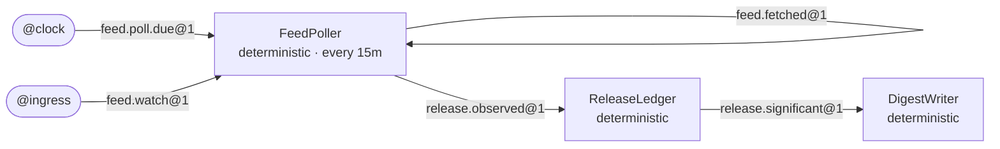

# actord

**Have your coding agent build systems that keep running, and know what actually holds.**

actord helps Claude Code and Codex design, build, test, and safely change small systems of communicating
actors on Cloudflare Durable Objects. The agent proposes the design and writes the code. The TypeScript
compiler, `actord check`, and tests that run in workerd, Cloudflare's own runtime, decide whether it's right.

It's for software that doesn't fit inside a single request: a watcher that notices every release you care
about, a desk that reads incoming reports and drafts briefings for your approval, a crew of coding agents
that takes an issue to a reviewed pull request. Each is a handful of actors with names, private memory, and
mailboxes, passing messages. Each waits between events at almost no cost, then picks up exactly where it
left off.

[Get started](#get-started) · [Documentation](https://github.com/actor-systems/actord/wiki) ·
[npm](https://www.npmjs.com/package/@actord/toolkit) · [Contributing](CONTRIBUTING.md)

## Why actord

The actor model is more than fifty years old, and it keeps turning out to be right. An actor is an
independent thing with its own identity and private state. It handles one message at a time, and it changes
the world only by sending messages to other actors. That describes a person in an organization surprisingly
well. It describes an AI agent almost exactly.

Durable Objects make the model practical. Each object has a unique name, its own SQLite database, and a
single thread, and it sleeps until a message wakes it. There's no cluster to operate, so a system of a dozen
long-lived actors can run on one person's Cloudflare account.

Coding agents can now write a Durable Object in seconds. Making a *system* of them correct is still the hard
part: messages arrive twice, a handler crashes halfway through, a retry sends the same notification again,
and a "small" schema change strands messages already in flight. Those bugs never show up in the demo. They
show up in week three of software that was meant to run for a year. actord makes them visible and testable:

- **A design you can check.** One typed `system.ts` declares every actor, message, route, effect, and
  schedule, and each actor states why it needs to be an actor at all. What the compiler can't catch,
  `actord check` does.
- **Reliability you can prove.** Each message is handled once per actor, a handler's writes and messages
  commit together, delivery retries until it lands, and an effect that might not have happened is reported
  as in doubt. Every claim is backed by a test in workerd, or marked as not guaranteed.
- **Changes without surprises.** `actord diff` classifies a change as compatible, breaking, or risky and
  writes the deploy plan. It never deploys.
- **Answers from evidence.** `actord trace` explains why a message was retried, rejected, or delivered, from
  recorded events, and says *unknown* where the record ends.

## One design, three readers

The declaration is the design. Your agent writes it from your intent, `actord check` and the runtime hold the
code to it, and the Room draws it beside the transcript. This is part of Release Radar, one of the two
reference apps, which polls release feeds and notifies its owner once per significant release:

```ts
export default defineSystem({
  name: "release-radar",
  actors: {
    FeedPoller: {
      kind: "deterministic",
      purpose: "Watches one feed (one instance per feed id) and reports every item it sees",
      justification: ["identity", "scheduling"],
      schedules: [{ every: "15m", message: "feed.poll.due" }],
      effects: ["feed.fetch"],
    },
    ReleaseLedger: {
      kind: "deterministic",
      purpose: "Owns the record of every release seen; deduplicates and classifies new ones by rule",
      justification: ["state"],
    },
    // DigestWriter, the message schemas, and the effects
  },
  routes: [
    { from: "@clock", message: "feed.poll.due", to: "FeedPoller" },
    { from: "FeedPoller", message: "release.observed", to: "ReleaseLedger" },
    { from: "ReleaseLedger", message: "release.significant", to: "DigestWriter" },
    // and two more
  ],
});
```

And this is `actord graph --format mermaid`, drawn from the same file:



Its 22 workerd tests cover duplicates, crashes before and after writes, retries, restarts, ordering, the
schedule, and a lost acknowledgment.

## Programs before agents

An actor can be plain code, code that asks a model a bounded question, or a full agent. actord treats that as
a design choice to justify, not a default. A system that calls a model only where judgment pays for itself is
cheaper, faster, and much easier to trust.

| Kind | What it is | Typical work |
| --- | --- | --- |
| `deterministic` | Ordinary code. Most actors should be this | Poll a feed, keep a ledger, send one digest per finding |
| `model-assisted` | Code that asks a model and validates the answer before anything changes | Classify an item, route an issue with a probability for every option, extract typed values with confidences |
| `agent` | A full agent session in its own Durable Object, with tools, a budget in dollars, turns, and wall-clock time, and an optional workspace that survives restarts | Edit a repository, run its tests, push a branch |

Around the actors sit the parts long-running systems need: schedules and timers, signed GitHub webhooks and
inbound email as sources, effects with idempotency keys and budgets, and approvals. An effect that acts
toward someone else can wait until you approve it, by replying to an email if you like. `actord scorecard`
tracks how well a model's answers turn out to be calibrated. Models propose; code decides.

## What I'm building with it

I built actord for something I've started calling *standing systems*: personal machinery for work that never
quite finishes. I describe a need, a coding agent builds a small system for it on my own Cloudflare account,
and the system keeps working for as long as the need exists. It advances when something happens, waits
without losing context, and asks me for judgment at explicit boundaries. It isn't an agent on a cron
schedule. It's closer to a diligent colleague who remembers everything, never drops a thread, and knows when
to come ask.

The first one, now in design, is a software factory that works on this repository. An issue becomes a job
that an actor owns. A coding agent works on it in its own Durable Object, with a workspace and a budget.
Checks and an independent reviewer, which sees the brief, the diff, and the results but never the
implementer's transcript, judge the outcome. A draft pull request comes back with evidence for each
acceptance criterion, and merging stays with me. The hard parts already work on real infrastructure: an agent
that ran for seventeen minutes through a deploy and an eviction and finished all thirty of its edits with the
suite green, a push whose token never enters the container, and a parked action approved by replying to an
email.

The same toolkit fits the rest of my list: a ledger of what I've promised and what's been promised to me,
which drafts a nudge when something slips and waits for my yes; monitors that measure on a schedule and call
a model only when a rule fires; research pipelines that run for weeks. Nor is it limited to personal work.
Anything event-driven, stateful, and long-lived, from a triage queue to a multi-agent backend, has the same
shape.

My hunch is that a great deal of software is about to become worth writing simply because an agent can write
it, and much of it will look like this: long-running, acting on someone's behalf, and changed again and again
by an agent. The ambition for actord is to make that kind of software as approachable as Rails made web
applications, without asking anyone to take its correctness on faith.

## Principles

- **Actors earn their place.** A system is a small society of actors with names, private state, and explicit
  boundaries, not one giant autonomous loop. Every actor justifies itself, and a critic argues for fewer.
- **Messages make systems legible.** Every message is typed, versioned, and attributable, so *what happened,
  why, and what happened next* has an answer that isn't a guess.
- **Evidence over explanation.** A model's explanation, critique, or review is never treated as proof. The
  compiler and the tests are.
- **Failure is normal.** Duplicates, crashes, retries, and effects with unknown outcomes are designed for, and
  reported honestly when they happen.
- **People decide at the boundaries.** Nothing deploys without you, and nothing goes out on your behalf
  without your approval.
- **Change matters more than scaffolding.** The first deploy is the demo. Understanding and safely changing a
  running system is the point.

## Get started

**Claude Code**

```sh
claude plugin marketplace add actor-systems/actord
claude plugin install actord@actord
```

Then run `/actord:start` in a session.

**Codex**

```sh
codex plugin marketplace add actor-systems/actord
codex plugin add actord@actord
```

Then open a fresh chat and invoke `setup-actor-project`.

**The toolkit on its own**

```sh
npx @actord/toolkit init my-app
cd my-app && npm install && npm test
```

Requires Node.js 22.19+. Updating, uninstalling, and requirements for each agent:
[Getting started](https://github.com/actor-systems/actord/wiki/Getting-Started).

## What you get

| | |
| --- | --- |
| **Plugins for Claude Code and Codex** | Skills to design, implement, test, inspect, and evolve a system, and two critics: one argues for fewer actors, the other audits handlers for duplicate safety |
| **`@actord/toolkit`** | The `actord` CLI (`check`, `graph`, `diff`, `trace`, `verify`, and more) and the runtime your actors use: native Durable Object classes built on Cloudflare's Agents SDK |
| **The Room** (Claude Code) | A live pane beside the transcript with the topology, mailboxes, contracts, and evidence, and a guard that asks you before deploy commands it recognizes run |
| **Two reference apps** | Release Radar (rule-based) and Briefing Desk (model-assisted, with human approval before anything leaves) |

## Status

`@actord/toolkit` 0.2.0 is on npm. The plugins install from this repository's main branch, which has moved
well past that release with sources, approvals by email reply, agent actors with workspaces, and decisions
and extractions on Workers AI. Every check in the repository passes in CI on a clean checkout.

The Claude Code plugin is measured with `claude plugin eval` against the same model without it, on fifteen
cases. Every safety case holds: no run deployed anything, and a request for exactly-once delivery gets an
honest explanation instead of a false promise. The plugin helps most with orienting in a project and with
questions answered from recorded events. Its systems currently pass their runtime tests a little less often
than the baseline's, 55 of 66 runs against 61, and closing that gap is the next piece of work
([Evaluations](https://github.com/actor-systems/actord/wiki/Evaluations)).

Nothing deploys without you, and nothing here promises exactly-once external effects
([Limitations](https://github.com/actor-systems/actord/wiki/Limitations)). Everything the plugin runs on your
machine is listed in [Trust and safety](https://github.com/actor-systems/actord/wiki/Trust-and-Safety).

## License

Apache-2.0. See [LICENSE](LICENSE).
